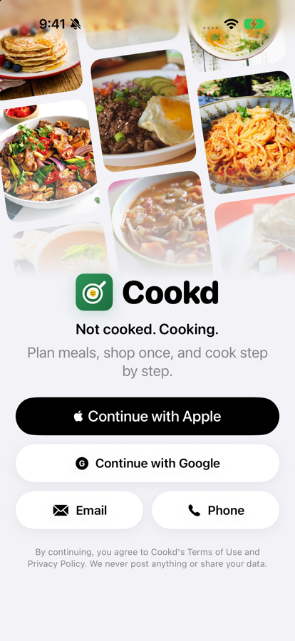
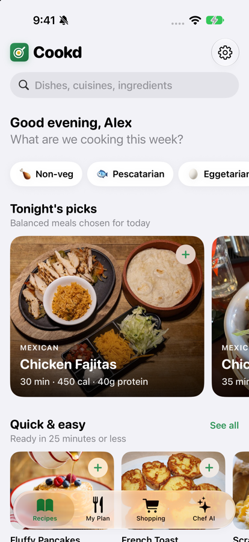
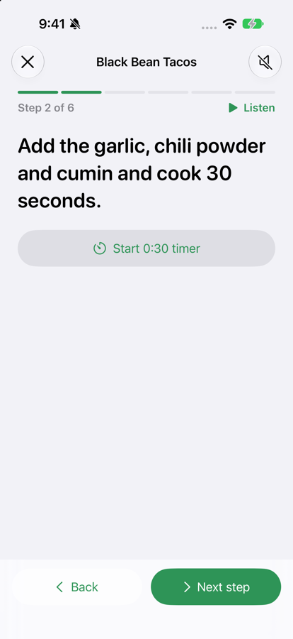
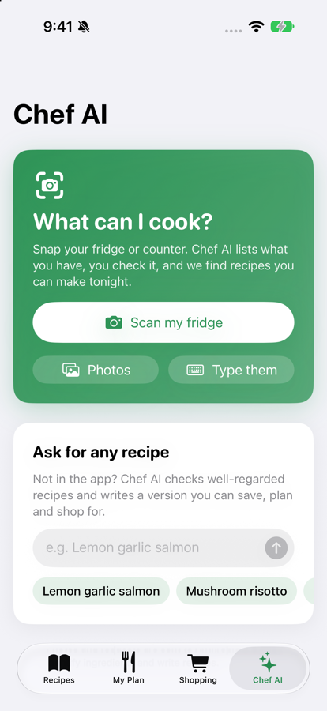
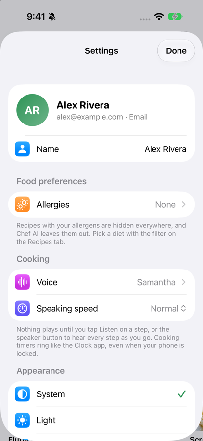

# Cookd

*Not cooked. Cooking.*

Cookd is an iOS meal-planning app for people who cook for themselves. Pick a few recipes, and Cookd builds one shopping list sized to real store packages and sorted by aisle. Then it walks you through cooking step by step, with timers and an optional read-aloud voice. Its Chef AI can suggest dishes from a photo of your fridge, or write a recipe for any dish you ask for.

Built with SwiftUI. (The Xcode project, folders and bundle ID still use the app's earlier name, **PlatePlan**.)

<p>
  
  
  
  
  
</p>

---

## Build and run

### Requirements
- A Mac with **Xcode 27**
- An iPhone simulator, or an iPhone, running **iOS 26.1 or later**

No other tools or packages need installing. The project has no third-party dependencies.

### Steps
1. Clone the repository and open the project:
   ```sh
   git clone https://github.com/slowmars/ECS191.git
   cd ECS191/homework1-part2
   open PlatePlan.xcodeproj
   ```
2. At the top of the Xcode window, choose the **PlatePlan** scheme and an **iPhone simulator** (for example, iPhone 18 Pro).
3. Press **Run** (⌘R).

That's all you need for everything except Chef AI.

### Optional: turn on Chef AI
Chef AI calls Anthropic's Claude API, so it needs an API key. The key is **not** in this repository. Without one, the app builds and runs normally, and the Chef AI tab explains how to add a key.

1. Get a key at <https://platform.claude.com/settings/keys>.
2. In the project folder, copy the template:
   ```sh
   cp Secrets.example.xcconfig Secrets.xcconfig
   ```
3. Open `Secrets.xcconfig` and paste your key after the `=`:
   ```
   ANTHROPIC_API_KEY = sk-ant-...
   ```
4. Build and run again. `Secrets.xcconfig` is in `.gitignore`, so the key is never committed.

### Running on a real iPhone
Select the **PlatePlan** target › **Signing & Capabilities** and choose your own **Team**. If Xcode says the bundle ID is taken, change it to something unique, such as `com.yourname.Cookd`. Do the same for the **PlatePlanTimerWidget** target, keeping it `<your app ID>.TimerWidget`.

### Running the tests
Press **⌘U** in Xcode, or run:
```sh
xcodebuild test -project PlatePlan.xcodeproj -scheme PlatePlan -destination 'platform=iOS Simulator,name=iPhone 18 Pro'
```
(Use any iPhone simulator you have installed.) There are 60 unit tests (Swift Testing). They cover the recipe data, unit conversion, the shopping list, AI response handling, diet and allergen detection, accounts and more.

---

## How to use Cookd

### 1. Sign in
Create an account with **Email** (name, email and password) or **Phone**, then tell Cookd your name. The home screen greets you by it ("Good morning, Alex"), changing with the time of day. A short welcome screen explains the app the first time.

Each account has its own meal plan, shopping list and saved recipes. See [Accounts](#accounts-what-works-today) for what's real and what's a demo.

### 2. Recipes tab: find something to cook
- **Diet filter:** the chips under the greeting are 🍗 Non-veg, 🐟 Pescatarian, 🥚 Eggetarian, 🧀 Vegetarian and 🌱 Vegan. Nothing is selected at first, so every recipe shows. Tap a chip to filter the whole app, including shelves, search, categories, Tonight's picks, scan results and Chef AI. Tap it again, or tap **Clear**, to reset. The choice is saved to your account.
- **Tonight's picks:** five balanced meals, a new set each day.
- **Shelves:** Quick & easy, Healthy & balanced and World flavors, then **Browse by category**. **See all** opens a grid you can sort (quickest, most protein, fewest calories) and filter by health tag.
- **Search:** by dish, cuisine or ingredient. If nothing matches, one tap hands the search to Chef AI.
- **Recipe page:** photo, health tags, nutrition, ingredients and steps. Change the servings and every amount updates. Tap **+** to add it to your plan.

### 3. My Plan tab
Every meal you've planned, with its servings. Tap **Cook** to start cooking mode. Progress shows as "2 of 4 meals cooked". You can remove cooked meals, or start a new plan.

### 4. Cooking mode
- **Gather ingredients:** choose servings and check off ingredients, then tap **Start cooking**.
- **One big step at a time:** swipe, or use Back and Next. The screen stays on.
- **Timers:** steps that mention a time ("simmer 15 minutes") get a one-tap timer. Timers ring like the Clock app, even if the phone is locked or the app is closed, and show a countdown on the Lock Screen and in the Dynamic Island.
- **Read aloud:** nothing plays on its own. Tap **Listen** to hear one step, or the **speaker** button (top right) to hear every step as you reach it. Pick the voice and speed in Settings.
- **Finish:** the last page marks the meal as cooked in your plan.

### 5. Shopping tab
- **One combined list** for every planned meal, sorted by aisle, in amounts you can actually buy ("1 dozen", "8 oz bag (2 cups)", "about 1½ lb").
- **Check items off** as you shop, and share the list as text.
- **Swipe left** on an item to mark it **Have it** (already at home) and remove it from the list. Staples like salt and oil are assumed.
- **Use up your leftovers** suggests extra meals that finish food you'd otherwise waste, such as half a tub of yogurt.

### 6. Chef AI tab (needs an API key)
- **What can I cook?** Snap your fridge, choose a photo, or type what you have. Check the list Chef AI found, then see **Cook now** recipes (you have everything), **Chef AI ideas** made from exactly what you have, and recipes that need a few more items.
- **Ask for any recipe:** type a dish, or tap a suggestion. Chef AI looks at well-regarded versions on the web and writes a simple home recipe for 1–2 servings, unless you name a number ("lasagna for 6"). You can change it ("make it spicier"), cook it, or **Save & add to plan**.
- Chef AI follows your diet filter and leaves out your allergens.

### 7. Settings (⚙︎ on the Recipes tab)
- **Name**
- **Allergies:** peanuts, tree nuts, dairy, eggs, gluten, soy, fish, shellfish or sesame. Recipes containing them are hidden everywhere.
- **Voice and speaking speed** for read-aloud
- **Appearance:** System, Light or Dark
- **Photo credits**
- **Sign out** and **Delete account**

---

## Accounts: what works today
Accounts are stored **on the phone** (`PlatePlan/Models/AccountStore.swift`). There's no server yet.

| Sign-in method | Status |
|---|---|
| **Email + password** | Works on this device. Passwords are stored as salted SHA-256 hashes, never as plain text. |
| **Phone** | **Demo:** no text message is sent, so any 6-digit code works. The screen says so. |
| **Sign in with Apple** | The code is complete, but it needs a paid Apple Developer team. To enable it, set `DEVELOPMENT_TEAM` in `project.yml` to that team, uncomment the `entitlements` block there, and run `xcodegen generate`. |
| **Google** | Shown as "coming soon" |

**Planned next step:** move sign-in to Firebase Authentication. It's free for email, Apple and Google sign-in, and lets an account work across devices. Only `AccountStore` changes; the screens stay the same.

---

## How it works

### Recipe data
There are **74 recipes**, written by hand: well-known US home dishes, plus famous dishes from 11 other cuisines (Mexican, Italian, Indian, Chinese, Mediterranean, Greek, Thai, Japanese, Middle Eastern, Caribbean and Korean). Each one has at most 10 ingredients to buy and 8 steps, in US units. 13 recipes are vegan and 30 are vegetarian.

The recipes and the ingredient catalog (store package sizes and typical prices) live in `Scripts/build_recipes.py`. Running `python3 Scripts/build_recipes.py` checks every recipe against these rules and writes `PlatePlan/Resources/recipes.json` and `ingredients.json`.

**Health tags** are computed from nutrition:
- *Balanced*: 300–700 calories, at least 20% of calories from protein, at most 35% from fat and 30–60% from carbs.
- *High protein*: 30 g or more per serving.
- *Veggie-packed*: 3 or more vegetables.

### Diet and allergen detection
`PlatePlan/Models/Diet.swift` works out each ingredient's food groups (meat, seafood, eggs, dairy, honey) and allergens from its name and grocery aisle. It handles look-alikes: coconut milk isn't dairy, eggplant isn't egg, corn tortillas and rice noodles are gluten-free, hummus has sesame, and pesto has tree nuts. Results are cached, so filtering stays instant. This can't detect traces or cross-contact, so the app tells people to read labels.

### The shopping list and the use-it-up algorithm
1. **Merge:** every planned ingredient is scaled to its servings and combined by name. Volumes (tsp, tbsp, cup) and weights (oz, lb) are converted to one unit.
2. **Buy whole packages:** for each ingredient, the app buys the fewest store packages that cover what you need. Meat sold by weight is rounded up to the nearest ¼ lb.
3. **Measure leftovers:** whatever is left in the last package is a leftover. Perishable leftovers (dairy, fresh produce, opened jars) are flagged as possible waste.
4. **Suggest meals:** for each recipe that uses a perishable leftover, the app rebuilds the whole list with that recipe added, at every serving size from 1 up to double the recipe. It keeps the options that use up the most leftovers while adding the least new shopping. Typical grocery prices decide which leftovers matter most; a cup of cream matters more than a clove of garlic. Prices are never shown. This search runs in the background, so the screen never freezes.

### How Chef AI stays accurate (without training a model)
Chef AI uses Claude (`claude-opus-5-5`), which already recognizes food in photos. Accuracy comes from how the feature is designed:
1. **Strict scanning rules:** list only items that are clearly visible. Read labels. Never guess common fridge items. If something could be one of several look-alikes (a red jar could be jam, salsa or sauce), leave it out.
2. **Shared ingredient names:** the AI maps what it sees onto the app's own ingredient names, so scan results line up with recipes.
3. **Guaranteed format:** every response must match a JSON Schema (structured outputs), so the app never parses free-form text.
4. **Confidence:** items it's only fairly sure about are marked "Probably", and guesses are dropped.
5. **You review the list** before any recipes are suggested.
6. **Grounded recipes:** written recipes are based on a few well-regarded versions found with web search, then checked for ratios, times and temperatures.

### Design
The interface uses a small design system (`PlatePlan/Design/Theme.swift`): a 4-pt spacing scale, three corner radii, rounded SF headings, one card style and one press animation. The logo (a winking egg in a pan) is drawn in SwiftUI in `PlatePlan/Design/CookdMark.swift`, and the app icon is rendered from that same code by `Scripts/render_icon.swift`.

| Principle | Where it shows up |
|---|---|
| **Fitts's law** (big targets near the thumb) | Chef AI on the far right of the tab bar; actions in bottom bars; every tap target is at least 44 pt |
| **Hick's law** (fewer choices) | Shelves show at most 10 recipes; one diet filter row; "Use it up" is one tap away instead of crowding the list |
| **Jakob's law** (familiar patterns) | Horizontal shelves and a featured carousel, like the App Store |
| **Miller's law** (chunking) | Recipes grouped into shelves and categories; ingredients, steps and nutrition in separate tabs |
| **Von Restorff effect** (what stands out gets noticed) | Large featured photo cards; one filled primary button per screen |
| **Goal-gradient and Zeigarnik effects** | "1 of 4 meals cooked", shopping and step progress, a "meals left" banner on the home screen |
| **Peak-end rule** | Cooking ends with an "Enjoy your meal!" screen |
| **Doherty threshold** (instant feedback) | Buttons react on press with haptics; heavy work runs in the background; AI waits show a pulsing sparkle and live status lines |
| **No dead ends** | A search with no results hands off to Chef AI; every empty screen has one clear next step |
| **Accessibility** | Dynamic Type, VoiceOver labels, dark mode, Reduce Motion respected, text scrims on photos |

---

## Project layout
```
PlatePlan/                  The app
  PlatePlanApp.swift        App entry: sign-in gate, per-account data, shared services
  Models/                   Recipes, diet and allergens, accounts, units, ingredient catalog,
                            meal plan, shopping list, use-it-up advisor, recipe matching
  AI/                       Claude API client, ingredient scanner, recipe writer, recipe ideas, photo search
  Speech/                   Read-aloud (AVSpeechSynthesizer)
  Timers/                   Cooking timers (AlarmKit)
  Design/                   Theme, logo, keyboard helper
  Views/                    SwiftUI screens (Account/ for sign-in and Settings, Chef/ for Chef AI)
  Resources/                recipes.json, ingredients.json, photo-credits.json (generated)
  Assets.xcassets/          App icon, accent color, recipe photos
PlatePlanWidget/            Lock Screen and Dynamic Island timer (Live Activity)
Shared/                     Code shared by the app and the widget
PlatePlanTests/             Unit tests
Scripts/                    build_recipes.py (recipes and catalog), fetch_photos.py (photos), render_icon.swift (app icon)
project.yml                 XcodeGen spec (the .xcodeproj is generated from it, and committed)
Config.xcconfig             Build settings; optionally includes Secrets.xcconfig
```
If you change `project.yml`, regenerate the project with `xcodegen generate` (`brew install xcodegen`). You don't need it just to build.

## Credits
- **Photos:** 74 food photos from Wikimedia Commons (Creative Commons licenses) and TheMealDB, bundled with the app. Every photo is credited in **Settings › Photo credits**. To refresh them, run `python3 Scripts/fetch_photos.py`.
- **AI:** Claude by Anthropic.

## Security note
For this class project, the API key is built into the app, which is fine on your own device. A public App Store release should send AI requests through a small server that holds the key, because anyone with the app could extract a key stored inside it.
